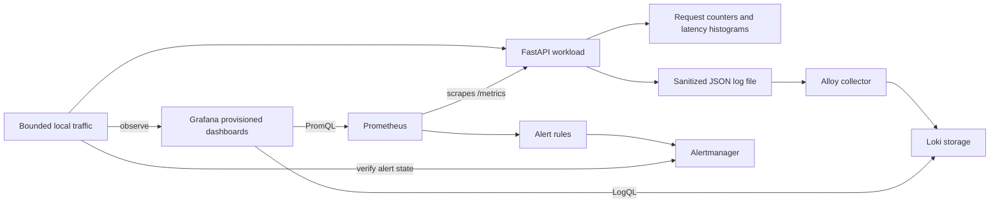
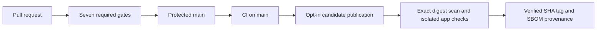

# Observability Platform — Metrics, Alerting and Logs

**Project 3 · Phases 1–2.** A hands-on SRE and DevSecOps lab built on the
[DevSecOps Starter Template](https://github.com/Mishkaaass/devops-starter-template).
Measure a real FastAPI workload, inspect latency and failures, observe an alert
when the service stops, then confirm recovery. No real cloud, external alert
receiver, Kubernetes cluster or production account is needed.

*Developed by Moshe Bogo*

[](https://github.com/Mishkaaass/observability-platform/actions/workflows/ci.yml) [](LICENSE)

**Status:** Phase 1 metrics/alerting passed all seven required checks and real Docker integration in [PR #5](https://github.com/Mishkaaass/observability-platform/pull/5). Phase 2 adds real centralized logs, subject to its own CI evidence. OpenTelemetry and Tempo are planned next. This is not a final release.

## Learn by doing

Follow the [step-by-step engineering learning path](docs/LEARNING_PATH.md): what each component does, why the design exists, exact commands, expected observations, and how to distinguish real evidence from a simulation. It grows with each phase.

The current Prometheus and Alertmanager references are security-scanned pinned upstream development snapshots, not stable releases. See [image source records](docs/IMAGE_SOURCES.md) for the reason, evidence and migration policy.

## What happens in this lab?



| Component | Why it exists |
| --- | --- |
| FastAPI | A real small workload to monitor, not fabricated telemetry |
| Prometheus | Scrapes counters and histograms every 5 seconds |
| Grafana | Visualizes the RED signals: rate, errors, duration |
| Alertmanager | Receives and tracks Prometheus alerts locally |
| Alloy | Reads the dedicated rotating workload file without host privileges |
| Loki | Stores and queries real structured events by bounded stream labels |
| SLI | Successful workload request fraction over a short teaching window |
| DevSecOps | Seven inherited quality/security gates, plus monitoring integration |

## Start locally

Use a trusted **local** Docker engine and Compose v2, Git, a browser, and Python
3.11+ for the stdlib traffic generator. Linux is the CI reference. Windows and
macOS use Docker Desktop Linux containers. Intel and Apple silicon routes are
documented, but not independently certified on every CPU/OS combination.

| OS | Setup |
| --- | --- |
| Linux | [Linux](docs/linux.md) |
| Windows | [Windows / WSL 2](docs/windows.md) |
| macOS | [macOS / Docker Desktop](docs/macos.md) |

After cloning the repository, or extracting the source kit, open a terminal in
its root. Check that the selected Docker context is your own local lab engine.
Stop any previous instance of this same lab occupying its ports; do not kill
unknown processes or change unrelated containers.

```bash
docker context show
docker compose version
docker compose config --quiet
docker compose up -d --build
docker compose ps
```

| Local URL | What to inspect |
| --- | --- |
| http://127.0.0.1:18000/ | Workload and `/health`, `/ready`, `/metrics` |
| http://127.0.0.1:13000/d/observability-overview | Provisioned Grafana dashboard |
| http://127.0.0.1:13000/d/observability-logs | Loki logs and HTTP 503 investigation |
| http://127.0.0.1:19090/targets | Prometheus workload target |
| http://127.0.0.1:19093/ | Alertmanager firing alerts |

Grafana is intentionally configured as a **local anonymous Viewer** with no
initial admin account and login disabled, not `admin/admin`. Prometheus and
Alertmanager are also local teaching UIs without authentication. Do not expose
these ports to a network or store real production data here. If provisioning
fails, inspect `docker compose logs grafana`; do not enable a default admin
password or change security settings just to make a test pass.

## Drill 1 — learn real measurements

Run one command at a time and watch Grafana after each scrape:

```bash
python3 scripts/generate_traffic.py healthy --count 30
python3 scripts/generate_traffic.py slow --count 30
python3 scripts/generate_traffic.py failure --count 60
```

Healthy returns HTTP 200, slow returns HTTP 200 after a fixed 350 ms wait, and
failure returns HTTP 503. These are bounded, stateless local exercises, enabled
only in the lab Compose service (`LAB_INCIDENTS=1`). They are disabled in the
normal published app image. Unknown paths, health probes and scrapes do not
inflate metric cardinality or workload totals. Request payloads and query
strings are not recorded in metrics or the structured workload logs.

Try these PromQL queries in Prometheus:

```promql
sum(rate(obs_http_requests_total[1m]))
100 * sum(rate(obs_http_requests_total{status="5xx"}[1m])) / sum(rate(obs_http_requests_total[1m]))
histogram_quantile(0.95, sum by (le) (rate(obs_http_request_duration_seconds_bucket[1m])))
```

A high error rate can trigger `HighErrorRate` when the threshold and hold time
are met. No traffic means no request availability evidence. `up=1` means the
scrape works, not that every request is successful.

## Drill 2 — detect and recover from a real service outage

**Only on your dedicated lab checkout**, after confirming `docker compose ps`
shows the intended workload, use these explicit commands:

```bash
python3 scripts/integration-observability.py healthy
docker compose stop starter
python3 scripts/integration-observability.py down
```

The last command verifies `up=0` and an active `WorkloadDown` alert received by
Alertmanager. Then restore the same container:

```bash
docker compose start starter
python3 scripts/integration-observability.py recovered
```

The verifier polls actual local APIs for recovery and alert clearance. The
receiver is deliberately local-only, with no external notification sink. If a
timeout occurs, inspect the logs rather than asserting that the test succeeded.

Safe shutdown: `docker compose stop` preserves the project's containers and
volumes. Do not use `down -v` on a reviewer's machine. The CI-only script creates
and cleans up a separate uniquely named disposable project.

## Drill 3 — find the request behind a metric

Generate fresh local events, then verify that the complete log path works:

```bash
python3 scripts/generate_traffic.py healthy --count 12
python3 scripts/generate_traffic.py failure --count 12
python3 scripts/generate_traffic.py slow --count 6
python3 scripts/integration-observability.py logs
```

Open http://127.0.0.1:13000/d/observability-logs and compare the request records with the RED dashboard. In Grafana Explore select Loki and try:

```logql
{service="workload"} | json
{service="workload"} | json | status = 503
{service="workload"} | json | duration_ms > 300
```

The app writes only its own sanitized JSON events to a small rotating file in a dedicated named volume. Alloy reads it read-only and forwards it to Loki; Grafana queries Loki through the internal datasource. Loki and Alloy have no host-published ports. The file has a 256 KiB rotation threshold and three backups; Loki has 24-hour retention configured, not a hard disk quota. Log delivery is best-effort in this local lab, not a production durability promise. See the learning path and security model.

## CI/CD and safety gates



The inherited pipeline keeps the exact seven gate names (code quality, Python
unit tests, dependency audit, secret scan, container security, browser/API
security and isolated API attack scan). The container gate additionally scans
all five pinned monitoring images, validates Loki and Alloy configuration, checks Prometheus rules and Alertmanager
config, starts a disposable stack, proves real scrape and dashboard behavior,
checks metric ingestion and the actual log path through Alloy, Loki and Grafana, stops the workload, verifies a delivered alert and
restores the workload. The image-publishing job remains opt-in and requires
protected current main and successful CI. It publishes the workload image,
not a deployment of the monitoring stack. No CI step uses a cloud credential.

To protect a new clean main, use `python3 scripts/github_setup.py --apply`.
After the real application checks pass on reviewed main, use
`python3 scripts/github_setup.py --apply --publish-image` to enable verified
GHCR publishing. GitHub admin access is required. Do not enable publishing
while the project is unprotected or before the real tests pass.

## Scope and next phases

- Phase 1: metrics, dashboards, local alerts, structured stdout, outage drill.
- Phase 2: centralized logs with Loki and Alloy (without privileged Docker socket); verify its own CI before claiming completion.
- Phase 3: OpenTelemetry and Tempo, trace/log correlation, meaningful SLO and
  error-budget burn rates, more service failure scenarios.
- Phase 4: interactive reviewer journey, end-to-end evidence, stable release.

See [security model](SECURITY.md) and [image source records](docs/IMAGE_SOURCES.md).
MIT licensed. No production or zero-vulnerability claim.
