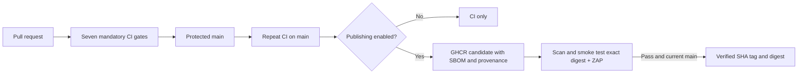

# DevSecOps Starter Template

A reusable, self-contained Python + Docker engineering baseline, derived from
the reviewed [OpsBoard CI/CD platform](https://github.com/Mishkaaass/ci-cd-lab).
The sample is a deliberately small stateless FastAPI service. Replace it with
your project and keep the safety gates; do not claim the sample tests prove
a new application's behavior.

## Create a new project

After the template has been verified and enabled in GitHub, select **Use this
template → Create a new repository**, or use GitHub CLI:

```bash
gh repo create observability-platform --template YOUR_GITHUB_USER/devops-starter-template --public --clone
cd observability-platform
```

Choose `--private` instead if the project must remain private (GitHub plan
restrictions may affect rulesets). GitHub template copies contain the CI/CD
files but not Actions variables, rulesets, package visibility, releases or
previous CI history. Do not copy tokens or environment credentials.

In the new clean main checkout, run `python3 scripts/github_setup.py` for a
read-only preflight, then `python3 scripts/github_setup.py --apply` to run CI
and configure strict branch protection **only after all seven gates pass**.
The script requires your own personal GitHub repository and admin access.
It refuses to modify the two existing portfolio labs. Use a PR for subsequent
changes. For image publishing, after adapting and validating the real app,
run `python3 scripts/github_setup.py --apply --publish-image` from reviewed
main. This enables `PUBLISH_IMAGE=true` and verifies CD. No custom token is
needed in the repository; the workflow uses the scoped GitHub Actions token.

## Run locally — choose your OS

| System | Native Python path | Container path |
| --- | --- | --- |
| Linux | [Linux](docs/linux.md) | Docker Engine + Compose v2 |
| Windows | [Windows PowerShell / WSL 2](docs/windows.md) | Docker Desktop |
| macOS | [Intel / Apple silicon](docs/macos.md) | Docker Desktop |

The sample is not an internet-facing service. Browse only
http://127.0.0.1:18000/. Native Python needs a project-local venv and pinned
packages; Docker builds an isolated image. No global pip, credentials,
Kubernetes cluster or AWS resources are needed. Linux is the CI reference;
Windows and macOS instructions are portable candidates, not runtime evidence.

## Delivery lifecycle



| Required gate | Purpose |
| --- | --- |
| Code quality | Ruff lint/format and Bandit static security |
| Python tests | Unit, API, setup policy and safety regression tests |
| Dependency security | pip-audit runtime dependency tree |
| Secret security | Gitleaks Git history / event-range scanning |
| Container security | Trivy config/image scans and disposable container smoke |
| API and browser security | Real HTTP tests and Chromium checks |
| Isolated API attack scan | ZAP against a fresh internal-network container, coverage required |

`Publish Docker image` is a post-merge job, not a PR gate. It requires all
seven successful jobs, a main push or manual main dispatch, explicit opt-in,
protected/current main, a verified exact published image digest, SBOM and
provenance. The reference implementation does not set a mutable `latest`
tag or deploy to any environment. A failed candidate is not a verified
release. All actions use reviewed commit SHAs. Dependabot proposes updates.

## Customize for the real project

| File | What to change |
| --- | --- |
| `app/` | Real application, health/readiness and version endpoints |
| `tests/` | Replace sample assertions with real functional/security/integration tests |
| `scripts/test-image.py` and `scripts/zap-coverage-hook.py` | Real API contract, access model and scan coverage; remove inapplicable CSRF exception |
| `Dockerfile`, `compose.yaml` | Actual services, verified image digests, least privilege and local isolation |
| `.github/workflows/ci.yml` | Extend the gates for real integrations; keep required names or migrate rules carefully |
| `requirements*.txt` | Reviewed compatible packages for the project |
| `README.md`, `docs/`, `SECURITY.md` | Actual architecture, run instructions, limitations and security model |

For Observability, add metrics, logs, traces, alert delivery, incident drills
and tests that prove each integration. For Kafka, add broker, producer,
consumer, failure and idempotency tests. Don't deploy the sample as the real
project. IaC-only projects need their own Terraform-specific gates; do not
blindly replace them with this Python pipeline.

## Validation and safety

Local unit tests and CI are separate evidence. GitHub's actual results are
required before claiming the template is operational. See [SECURITY.md](SECURITY.md)
for risk acceptance and boundaries. Stable releases should be created against
reviewed commit IDs; never overwrite existing release tags.

MIT licensed — see [LICENSE](LICENSE).
