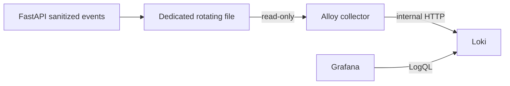

# Engineering learning path — build, observe, diagnose, recover

This guide is a running record of what the lab implements and why. Commands
below are for a dedicated local clone, never a production service. Expected
observations are hypotheses to verify, not screenshots or claims of a local
run. CI logs are independent evidence for the exact tested commit.

## 0. Understand the three portfolio projects

Imagine a food delivery service:
- Terraform AWS Lab builds the roads, buildings and access rules (infrastructure).
- OpsBoard CI/CD delivers reviewed updates to the service safely (software delivery).
- Observability Platform measures whether the service is healthy and helps find faults (operations).

These are independent educational repositories, not a single deployed cloud system.

## 1. Metrics: instrument the application

**Built:** FastAPI workload, request counters and latency histograms using
prometheus_client, fixed local healthy/slow/failure routes, structured logs.

**Why:** without instrumentation the engineer cannot distinguish traffic growth
from errors or slow responses. A counter records completed events; a histogram
records how observations fall into buckets. A rate is the counter's change
per second, not the raw cumulative total.

**Security design:** only fixed route names and status classes are metric labels.
User IDs, paths containing input, headers, bodies and query values would leak
data or create unbounded cardinality. Incident routes are enabled only in lab
Compose and have bounded delays, no state changes, and no remote targets.

After all CI gates pass, start the isolated stack from the repository root:

```bash
docker compose config --quiet
docker compose up -d --build
docker compose ps
curl --noproxy '*' -fsS http://127.0.0.1:18000/metrics
```

Inspect `obs_http_requests_total` and
`obs_http_request_duration_seconds_bucket`. The initially zero series are
intentional. `/metrics` and health checks are excluded from business counters.

## 2. Prometheus: store and query actual measurements

**Built:** scrape and rule evaluation every five seconds, bounded local
retention, provisioned rules and deterministic promtool tests.

**Why:** the app exposes the current values; Prometheus keeps time series
so you can see when a fault begins and whether recovery persists.

Run these drills separately while watching the Prometheus UI:

```bash
python3 scripts/generate_traffic.py healthy --count 30
python3 scripts/generate_traffic.py slow --count 30
python3 scripts/generate_traffic.py failure --count 60
```

At http://127.0.0.1:19090/graph query:

| PromQL | Interpretation |
| --- | --- |
| `up{job="workload"}` | 1 = successful scrape, 0 = failed scrape |
| `sum(rate(obs_http_requests_total[1m]))` | Requests per second (traffic) |
| `sum(rate(obs_http_requests_total{status="5xx"}[1m]))` | Failed requests per second |
| `histogram_quantile(0.95, sum by (le) (rate(obs_http_request_duration_seconds_bucket[1m])))` | Estimated p95 latency, in seconds |

A healthy response is HTTP 200; slow deliberately waits 350 ms;
failure returns 503. A p95 estimate describes the upper tail, not the average.
A healthy scrape does not prove a healthy workload.

## 3. Grafana: turn measurements into a dashboard

**Built:** a version-controlled dashboard and Prometheus datasource automatically
provisioned at boot. RED panels show real measured request rate, errors and
duration. The lab viewer cannot edit dashboards; no admin/admin credentials
are enabled.

Open http://127.0.0.1:13000/d/observability-overview .
Compare the graphs across the three traffic modes. The dashboard reads actual
Prometheus results; no traffic means no evidence of request success.

## 4. Alertmanager: detect a real outage and recover

**Built:** WorkloadDown with a 10-second hold time, HighErrorRate with a
minimum traffic threshold, local-only alert delivery, and a real integration
verifier.

**Why:** an alert should be actionable, not fire for every short scrape glitch.
Prometheus evaluates rules; Alertmanager receives, groups and tracks alerts.
It is not the component that calculates request rates.

In a dedicated lab only, verify healthy state before stopping the workload:

```bash
python3 scripts/integration-observability.py healthy
docker compose stop starter
python3 scripts/integration-observability.py down
docker compose start starter
python3 scripts/integration-observability.py recovered
```

**Expected evidence:** successful scrape -> failed scrape -> active WorkloadDown
in Alertmanager -> restored scrape -> cleared alert. The verifier polls actual
APIs with bounded deadlines. Alert receipt is local; this does not test
Slack/email or on-call delivery. Stop only the lab when done:
`docker compose stop`. Never remove a reviewer's volumes automatically.

## 5. DevSecOps: why the pipeline blocked the first PR

The inherited seven gates include lint/format, tests, dependency audit, secret
scan, image and configuration security, real browser/API tests and isolated
ZAP scan. The container gate additionally exercises the real monitoring stack.

The initial monitoring images failed on a fixable Go dependency vulnerability.
That is the intended behavior of the supply-chain gate. We scanned exact
candidate digests, chose candidates that passed the existing policy, and kept
the full integration check mandatory. Two are temporary upstream development
snapshots; replacing them with fixed stable releases remains a review task.
See [IMAGE_SOURCES.md](IMAGE_SOURCES.md) for exact evidence.

Never confuse an upstream tag with a fixed dependency, a passed image scan
with a tested runtime, or green CI with production certification.

## 6. Centralized logging: answer what happened

**Built:** an opt-in rotating JSON file in the app, Alloy as a read-only file
collector, a single-node Loki store, and a provisioned Grafana log dashboard.

**Why:** a metric is an aggregate. It tells you that requests failed but not
which events correspond to the graph. Imagine a food-delivery service:
the error graph shows an order failure spike, and a log shows the individual
operation, timestamp, response status and duration.

**Data flow:**



Alloy transports events; Loki stores and queries them. Loki indexes a small
set of stream labels, not every JSON field. Keep labels such as service and
environment bounded. Parse duration or status at query time; do not make
request IDs into labels. Timestamp describes when the event happened, not
when a collector happened to deliver it.

After the phase's integration passes, run:

```bash
python3 scripts/generate_traffic.py healthy --count 12
python3 scripts/generate_traffic.py failure --count 12
python3 scripts/generate_traffic.py slow --count 6
python3 scripts/integration-observability.py logs
```

Open http://127.0.0.1:13000/d/observability-logs and inspect real events.
In Grafana Explore, choose Loki and compare:

| LogQL | Meaning |
| --- | --- |
| `{service="workload"} | json` | Read workload stream and parse fields |
| `{service="workload"} | json | status = 503` | Locate failed requests |
| `{service="workload"} | json | duration_ms > 300` | Locate slow requests |

Compare the same time window on the RED dashboard. A simulated workload
failure is a real HTTP 503 with a real event, not a fake dashboard value.

**Proof:** CI must query fresh records through the actual Grafana datasource
proxy and find healthy, failed and slow events. Unit tests additionally
require the log schema, exclusion of request content and bounded file
rotation. This verifies the data path, not lossless delivery under overload.

**Security:** the collector only receives a read-only dedicated volume,
not the Docker daemon or host logs. Loki is not exposed directly. The
configured retention is a time limit, not a disk quota. The local anonymous
viewer is not a production authentication design. See [security](../SECURITY.md).

Vendor configuration references:
- https://grafana.com/docs/alloy/latest/reference/components/loki/loki.source.file/
- https://grafana.com/docs/loki/latest/configure/examples/configuration-examples/
- https://grafana.com/docs/loki/latest/operations/storage/retention/

## 7. Next: traces and SLOs

- **Traces (OpenTelemetry + Tempo):** connect request processing across
  services by trace ID and spans to locate latency and failure.
- **SLOs and error budgets:** set a measurable reliability target, distinguish
  no traffic from successful requests, and measure how fast errors consume
  the allowed budget.

These remain planned stages. Each receives its own source, tests, real
integration evidence and practical lesson.
